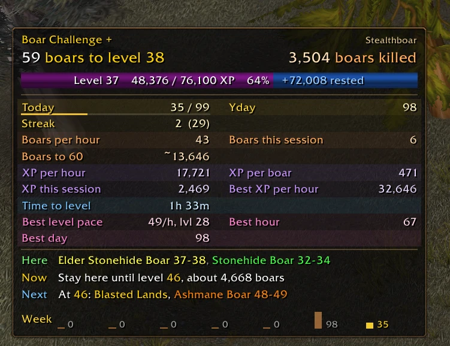
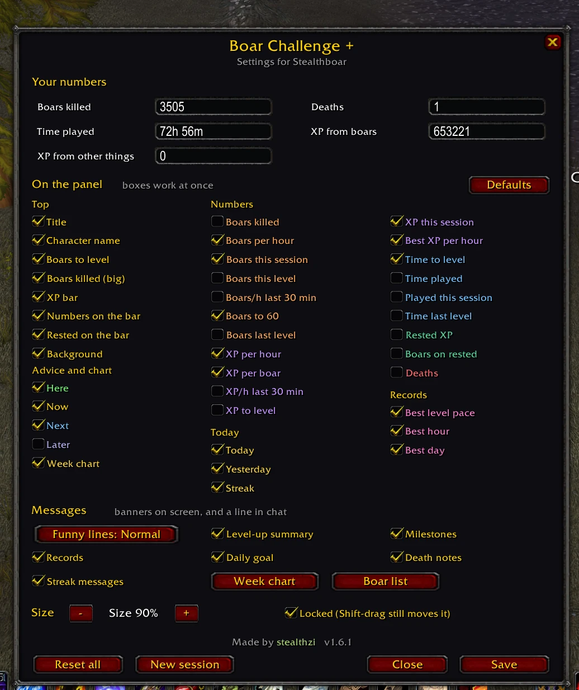
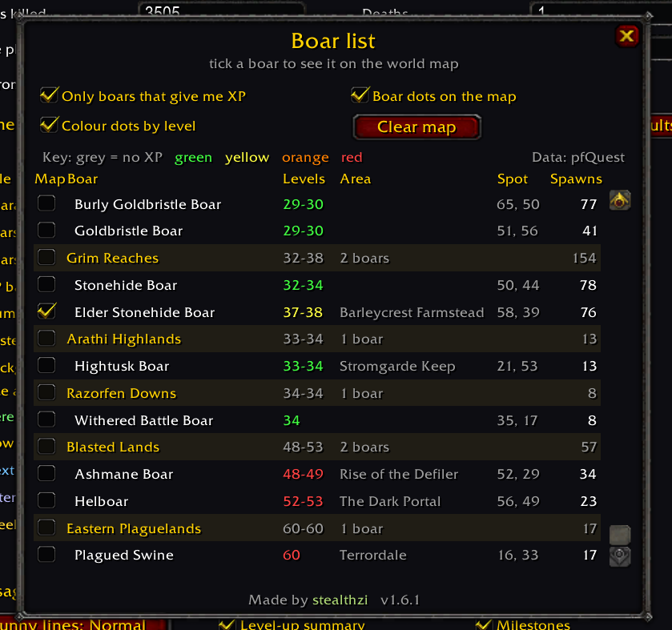
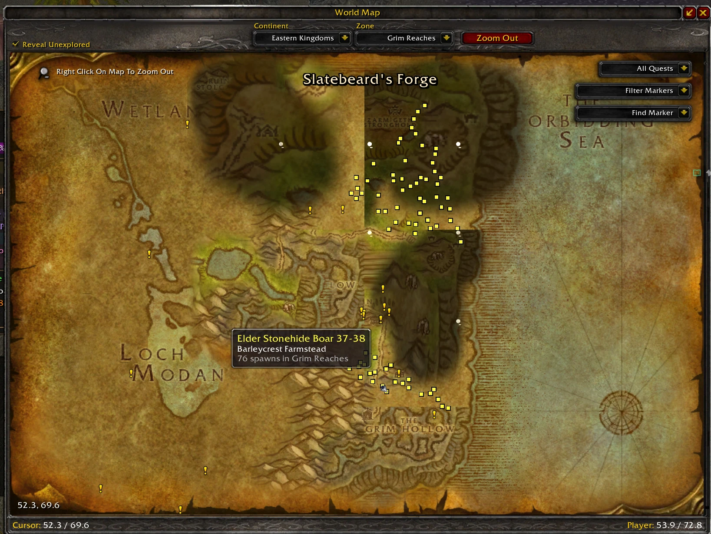

# Boar Challenge +

For a character that levels on boars alone, on the 1.12 client: plain vanilla WoW servers, Turtle WoW, OctoWoW and Ravencraft.

- A panel with the numbers that matter for the run.
- Every number can be switched off.
- A road of boar zones from your level to 60.
- Boar hunters Discord: https://discord.gg/J9uvxmYWxy

## Screenshots

The panel:



Settings:



Boar list:



Boar dots on the world map:



## Start

- Type `/boar` to show or hide the panel.
- It is remembered per character.
- Right-click the panel for settings.
- Hover the panel for your whole road.
- Shift-drag to move it.

## The panel

```
Boar Challenge +                                                    Stealthboar
59 boars to level 20                                       1,127 boars killed
[====== Level 19    7,366 / 21,300 XP    35%    +17,238 rested ====|~~~~~~~~~]
Boars per hour           90        Boars this session           30     (orange)
XP per hour          21,402        XP per boar                 238     (purple)
Time to level           39m        Time played             17h 00m     (blue)
Here   Great Goretusk 16-17, Goretusk 14-15, Young Goretusk 12-13
Now    Stay here until level 22, about 540 boars (or Redridge Mountains)
Next   At 22: Hillsbrad Foothills, Forest Boar 23-25
```

- **Big line**: boars to next level (left), boars killed (right).
- **XP bar**: rested XP shows in blue, with the amount.
- **Colours**: boars orange, XP purple, time blue, rested green, deaths red.
- **Here**: boars in this zone, biggest first. Grey gives no XP.
- **Now**: stay here until a level, or go somewhere better.
- **Next**: the next stop and the level to go.
- **Later**: the stops after that (off at first).
- **Today**: boars today and the day's goal, with a thin bar that fills toward it. Green when reached.
- **Yday**: boars yesterday.
- A day starts at 6 in the morning, so a late night counts with the evening before.
- **Streak**: boars in a row, your best in brackets.
- **Week chart**: 7 small bars under the panel, today in gold (off at first).

## Settings

- Right-click the panel, or `/boar edit`.
- Every box works as soon as you click it.
- **Top**: title, name, boars to level, boars killed, XP bar, bar numbers, rested, background.
- **Advice**: here, now, next, later.
- **Boars**: killed, per hour, this session, this level, last 30 min, last level, to 60.
- **XP**: per hour, per boar, last 30 min, to level, this session, best per hour.
- **Time**: to level, played, this session, last level.
- **Other**: rested XP, boars on rested, deaths.
- **Advice and chart**: the advice lines, and the small week chart.
- **Today**: today, yesterday, streak.
- **Records**: best level pace, best hour, best day (off at first).
- **Messages**: funny lines (Off, Rare, Normal), level-up summary, milestones, records, daily goal, death notes, streak messages.
- **Week chart** button: the big chart.
- **Boar list** button: every boar, and dots on the map.
- **Size**: smaller and bigger buttons, or `/boar scale 1.2`.
- **Lock**: then it only moves with Shift.
- **Defaults**: panel back to how it starts.

## Messages and records

- **Banners**: big text near the top middle, then a line in chat. One at a time.
- **Funny lines**: now and then while you kill. Rare is about every 15 minutes, Normal about every 7.
- **Level-up**: boars and time for the level, and how much faster or slower than the last one.
- **Milestones**: 100, 250, 500, 1,000, 2,500, 5,000, 7,500, 10,000 boars, then every 5,000.
- **Records**: best level pace, most boars in 60 minutes, most in a day, longest streak. Beat one: NEW RECORD! and a sound.
- The first time a record is set it stays quiet.
- Best level pace: boars per hour over a whole level. Only levels 5 and up the addon saw from start to end.
- **Daily goal**: one more than yesterday, or your own with `/boar goal 200`. A banner when you beat yesterday and when you reach it.
- No boars yesterday: the goal is one more than the last day you played.
- **Streak**: ends after 90 seconds with no boar, or when you eat, drink, go AFK or die. Banners at 5, 10, 25, 50, 100.
- **Death notes**: where you died, your level, and what hit you last. The last 50 are kept.
- **Week chart**: boars per day for the last 7 days. `/boar week`.
- Days count by your PC's clock. The last 14 are kept.

## Your numbers

- Settings window: boars killed, deaths, time played (like `14h30m`), XP from boars, other XP.
- Only boxes you change are saved.
- Or from chat: `/boar set kills 1000`, `/boar set played 14h30m`.
- Every character starts at 0.
- Stealthboar starts at 1000 (boars from before this addon).
- Old Boaring Challenge data: chat says once what it counted, and how to take it over.

## The road

- Worked out with the game's own XP rules.
- Boars 3 or 4 levels above you count half, 5 above not at all.
- You stay put until a zone is clearly better.
- Boar counts are estimates. Rested XP comes off the first stop.
- Dungeon boars and the other faction's lands count for less.

From Westfall at level 18:

| Levels | Where | Boars | Or |
|---|---|---|---|
| 18 to 22 | Westfall | Great Goretusk 16-17, Goretusk 14-15 | Redridge Mountains, Loch Modan |
| 22 to 27 | Hillsbrad Foothills | Forest Boar 23-25, Elder Forest Boar 26-27 | |
| 27 to 32 | Northwind | Young, Burly and plain Goldbristle Boars 26-30 | |
| 32 to 46 | Grim Reaches | Stonehide Boar 32-34, Elder Stonehide Boar 37-38 | Arathi Highlands |
| 46 to 58 | Blasted Lands | Ashmane Boar 48-49, Helboar 52-53 | |
| 58 to 60 | Eastern Plaguelands | Plagued Swine 60 | |

## Boar list and map dots

- `/boar list`, or the **Boar list** button in settings.
- Every boar by zone, lowest zone first.
- Each boar: levels in the game's colour, area, map spot, spawns.
- **Tick a boar**: its spawn points show as dots on the world map (and the minimap with pfQuest).
- **Tick a zone**: all its boars on the map.
- **Click a name**: the map opens on that zone, dots on.
- **Only boars that give me XP**: hides the grey ones, in the list and on the map. Follows you as you level.
- **Boar dots on the map**: all dots on or off.
- **Colour dots by level**: off = all dots boar orange.
- **Clear map**: unticks every boar.
- **Tick all**: ticks every boar in the list.
- Colours: grey = no XP, then green, yellow, orange, red.
- With pfQuest: a dot for every spawn point, on the world map and the minimap. Without: one bigger dot per boar, world map only.
- Hover a dot: boar, levels, area.
- Saved per character.

## Boar data

- With **pfQuest** (pfQuest-turtle, pfQuest-octo): boars come from its database, server zones included.
- Without it: a built-in list from that database (2026-09-25, vanilla plus Turtle WoW).
- On a plain vanilla server the built-in list leaves out Turtle WoW's own zones, so the road only uses zones you have.
- OctoWoW shows the same boars at the same levels.
- Boars on a zone's edge are kept in the zone they are really in.

## What counts

- **Kill**: "You have slain X!", "X dies, you gain N experience.", or "X dies." on your target (pet kills).
- **Boar**: anything the game calls a Boar when you target it.
- Also any name with boar, goretusk or agam'ar, and names you add with `/boar add`.
- **Boars to level**: uses what a boar gives without rested. Rested boars count double.
- **Boars to 60**: every stop of the road added up, by the game's XP rules. A rough guide.
- It uses your last boar before the first kill of a session, so it is right at login.
- **Per hour**: this session.
- **Time to level**: last 30 minutes (after 5 minutes played), else the session, else last time's pace.
- **Boars on rested**: rested pool over what a boar gives.
- **Played**: counts while logged in and not AFK.
- **Levels**: each level-up is saved with its boars and time. See `/boar levels`.

## Commands

| Command | What it does |
|---|---|
| `/boar` | Show or hide the panel (per character) |
| `/boar edit` | Settings: numbers, what shows, size |
| `/boar where` | Boars here, now, next and later |
| `/boar route` | Road to 60: stops, boars, map positions, boar counts |
| `/boar route all` | Every boar known, low to high |
| `/boar list` | Boar list window; tick boars to see them on the map |
| `/boar show <thing>` | One thing on or off; `/boar show` lists them |
| `/boar scale 1.2` | Panel size, 0.6 to 2 |
| `/boar set kills 1000` | Set `kills`, `deaths`, `played`, `xp` (boars) or `otherxp` |
| `/boar add <name>` | Count it as a boar (no name: your target) |
| `/boar remove <name>` | Stop counting it |
| `/boar kinds` | Boars killed, by kind |
| `/boar levels` | Each level with its boars and time |
| `/boar goal 200` | Daily goal; `/boar goal auto` = beat yesterday; `/boar goal` shows it |
| `/boar days` | Boars per day, last 14 days |
| `/boar week` | Chart of the last 7 days |
| `/boar records` | Your records |
| `/boar deaths` | Last 20 deaths: when, what hit you, where |
| `/boar lines off` | Funny lines `off`, `rare` or `normal` |
| `/boar session` | Session counters start again |
| `/boar lock` | Lock or unlock the panel (Shift-drag always works) |
| `/boar reset` | This character back to zero (asks twice) |
| `/boar help` | List the commands |

## Install

- Copy the `BoarChallengePlus` folder into `Interface\AddOns\`, or update through your launcher.
- Or run `node tools/install.js` from this folder.
- `node tools/check-lua.js .` checks the code (Lua 5.0, 1.12 API).
